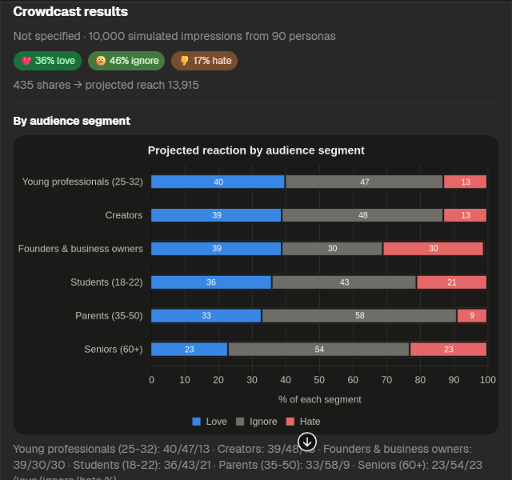
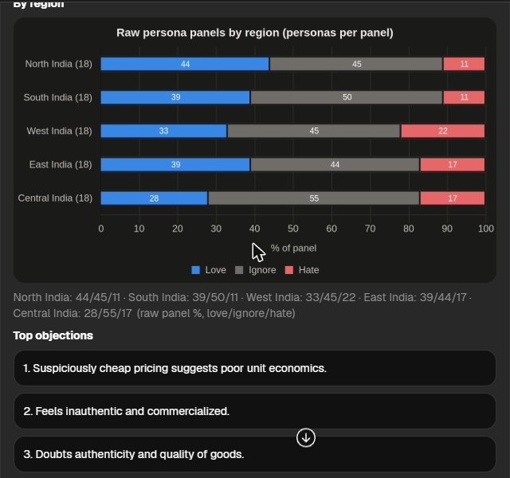

# Crowdcast — test anything on a simulated crowd


Built for **Fetch-A-Thon 3.0** (Fetch.ai Innovation Lab, Presidency University, Bengaluru).

## Problem
Founders, creators and marketers post pitches, reels and ads blind. Real audience testing is slow and expensive, so most content ships without ever being tested.

## What it does
In **ASI:One**, paste a startup pitch, Instagram post or ad and ask how people will react. Crowdcast drops it into a virtual crowd and returns:

- % of people who **love / ignore / hate** it across 10,000 (up to 100,000) simulated impressions
- which **audience segments** react best
- the **top objections**, plus real quotes from persona agents
- a **rewritten version** that answers those objections

The whole workflow runs inside an ASI:One conversation, with results shown as an **ASI:One interactive card**.

## Target users
Startup founders, student hackathon teams, Instagram creators, small D2C brands and marketers who want feedback before they post.

## How the "crowd" works (honest method)
1. Five regional crowd agents (north, south, west, east, central India) each hold an 18-person panel of distinct personas (age, city, interests, mood); all 90 genuinely react to the content via the ASI:One LLM, in parallel.
2. The simulation agent weights those reactions by audience segment and **statistically expands** them to N impressions, then applies a simple share model (people who love it and would share it create a second wave of reach).

The 10k/100k numbers are a weighted statistical expansion of real persona responses, not 100k separate LLM calls. The cards keep the two apart: segment numbers are projected, region numbers are the raw panels.

## Architecture
```
User (ASI:One chat, interactive cards, wallet)
   │  Agent Chat Protocol + Agent Payment Protocol
   ▼
Orchestrator @crowdcast ──► 5 regional Crowd agents, in parallel (90 personas, ASI:One LLM)
     │                  ──► Simulation agent (weighted expansion + share model)
     │                  ──► Rewrite agent    (improved copy, ASI:One LLM, fact-checked)
     ▼
Results card with charts, social post previews, before/after retest
```

### The five regional crowd agents
One crowd codebase runs as five hosted agents: **north, south, west, east and central India**. Each reads its region from the `CROWD_REGION` secret and builds an 18-person panel from a fixed seed (5 students, 5 young professionals, 3 parents, 2 founders, 2 creators, 1 senior) with that region's cities and names, so a panel is the same on every run. The orchestrator sends every pitch to all five at once, merges the 90 reactions, and moves on after 75 seconds with whichever regions answered, so one slow agent never blocks a report.

### The card flow in ASI:One
1. **Setup card** (say hi to `@crowdcast`): content, platform, target region, crowd size → *Run test*.
2. **Results card**: love/ignore/hate, projected reach, a segment chart and a region chart (dark-mode images from the real numbers, each with a text fallback), objections, persona quotes and the rewrite.
3. **Social preview**: the content as an Instagram, LinkedIn or X post with its crowd score, keyword hashtags and a format tip. Nothing is posted anywhere.
4. **Test the rewrite**: the rewrite goes through the same 90 personas on its own, and a before/after card only declares a winner when the gap is bigger than normal run-to-run noise (5 points).

### Honest rewrites
The rewrite agent may only rephrase facts that are in the original. A checker rejects new numbers, guarantees, promotions, superlatives and quality claims ("100% original", "most-loved", "or it's free"); the LLM gets one retry, otherwise the card says the rewrite is unavailable.

### Paid full report (Agent Payment Protocol, FET on testnet)
The orchestrator is a **seller** in Fetch.ai's Agent Payment Protocol. The free preview shows the headline numbers, the segment chart, the top two objections and the social preview. *Unlock full report* (or a paid button) sends a `RequestPayment` for 0.5 testFET to the user's ASI:One wallet. When the wallet answers with `CommitPayment`, the orchestrator verifies the transaction on the Fetch.ai stable-testnet ledger (right recipient, at least the price, from the buyer, never used before) and only then sends `CompletePayment` and the full report: region chart and details, every objection, quotes, the rewrite and the retest. Anything else gets `CancelPayment`. Payments switch on when the orchestrator has a `CROWDCAST_FET_WALLET` secret (a receiving address, never a private key); without it everything is free.

## Screenshots
Results card with the projected segment chart:



Raw regional panels and objections:



## Agents (all hosted on Agentverse)
| Agent | Address | Agentverse profile |
|---|---|---|
| crowdcast-orchestrator | `agent1q26xmt9hz654pcx0h5uhqr5ccg5syvd6d3gqsrhynmzetm72j0wlgdrdsj9` | [profile](https://agentverse.ai/agents/details/agent1q26xmt9hz654pcx0h5uhqr5ccg5syvd6d3gqsrhynmzetm72j0wlgdrdsj9/profile) |
| crowdcast-crowd-north | `agent1qw6elpnrg0wqsw59unxnw5ymynypt9wh0g8n47jf5v7250vxwsn872e5saf` | [profile](https://agentverse.ai/agents/details/agent1qw6elpnrg0wqsw59unxnw5ymynypt9wh0g8n47jf5v7250vxwsn872e5saf/profile) |
| crowdcast-crowd-south | `agent1qddxa9d59mzv6ggdmff8d0kd2c5hssdv2w3ufx5kd0uaaxec6tvrzj8u6xh` | [profile](https://agentverse.ai/agents/details/agent1qddxa9d59mzv6ggdmff8d0kd2c5hssdv2w3ufx5kd0uaaxec6tvrzj8u6xh/profile) |
| crowdcast-crowd-west | `agent1q0yyadpxdy50xrfa35r6jltp5mla7pspfa6aqu83e4pwvrtlmepqgpv09dy` | [profile](https://agentverse.ai/agents/details/agent1q0yyadpxdy50xrfa35r6jltp5mla7pspfa6aqu83e4pwvrtlmepqgpv09dy/profile) |
| crowdcast-crowd-east | `agent1q2vtvps6krssghyx7vctv3np6py4022jn5njs4pcdl6hpykjs6y3g97zdng` | [profile](https://agentverse.ai/agents/details/agent1q2vtvps6krssghyx7vctv3np6py4022jn5njs4pcdl6hpykjs6y3g97zdng/profile) |
| crowdcast-crowd-central | `agent1qf98p6vzlwdd3ze43x4q2e3ghptcxyje53khlp60qe64c8a3rfdnwq9yj9d` | [profile](https://agentverse.ai/agents/details/agent1qf98p6vzlwdd3ze43x4q2e3ghptcxyje53khlp60qe64c8a3rfdnwq9yj9d/profile) |
| crowdcast-simulation | `agent1qv4tvuw3sklnf2wuufq7dq6pnkqt8mq9kq03kyyjl0w9p9n44d4xvr6p0h2` | [profile](https://agentverse.ai/agents/details/agent1qv4tvuw3sklnf2wuufq7dq6pnkqt8mq9kq03kyyjl0w9p9n44d4xvr6p0h2/profile) |
| crowdcast-rewrite | `agent1qtumj924vkyrkzw6smrlkrg5ss0tqeevv34l4ehuhg88uttnxa7aq3wwrdl` | [profile](https://agentverse.ai/agents/details/agent1qtumj924vkyrkzw6smrlkrg5ss0tqeevv34l4ehuhg88uttnxa7aq3wwrdl/profile) |

## Try it
1. Open [ASI:One](https://asi1.ai/chat) and say hi to `@crowdcast` for the setup card, or paste your content directly, e.g. *"How will people react to this Instagram post: …"*
2. Optional: add `crowd 100k` to change the crowd size (default 10k).
3. On the results card try *Social preview* and *Test the rewrite*.

Shared demo chat: TODO_SHARED_CHAT_LINK · Demo video: TODO_DEMO_VIDEO_LINK

## Run / deploy it yourself
1. Create 9 hosted agents on [Agentverse](https://agentverse.ai) (Agents → Launch an Agent → Generate → Blank Agent): the orchestrator, simulation, rewrite and five crowd agents.
2. Paste each file from `agents/<name>/agent.py` into its agent's Build tab (all five crowd agents use `agents/crowd/agent.py`).
3. Add secrets: `ASI1_API_KEY` (from [asi1.ai](https://asi1.ai)) on the five crowd agents and the rewrite agent; `CROWD_REGION` = `north` / `south` / `west` / `east` / `central` on the crowd agents; optionally `CROWDCAST_FET_WALLET` (and `CROWDCAST_PRICE_FET`) on the orchestrator to turn on paid reports.
4. Put the crowd, simulation and rewrite addresses into `CROWD_AGENTS`, `SIM_ADDRESS` and `REWRITE_ADDRESS` at the top of `agents/orchestrator/agent.py`.
5. Start all 9 agents, then chat with the orchestrator.

Extra resources: ASI:One API key, Agentverse account, an ASI:One wallet with testnet FET for the paid flow. Charts are rendered by QuickChart (free tier; only labels and percentages are sent).

## Team
- TODO_NAME: Agent lead, orchestrator & integration
- TODO_NAME: LLM prompts (crowd + rewrite)
- TODO_NAME: Agentverse deployment & hosting
- TODO_NAME: Pitch, presentation & README
